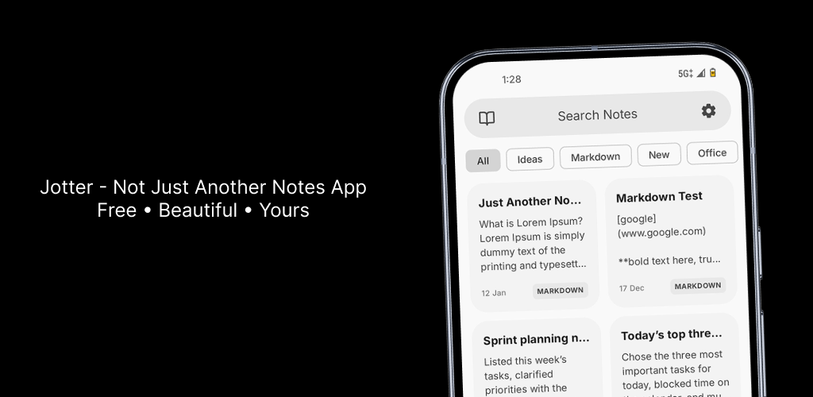

<p align="center">
    
</p>

<h1 align="center">Atena Notes</h1>

<p align="center">
    Um fork do <a href="https://github.com/OpenAppsLabs/Jotter">Jotter</a> — app de notas moderno, offline-first, sem anúncios e sem telemetria — com app Android, port para Linux e servidor de sincronização próprio.
</p>

---

## 📖 Sobre

**Atena Notes** é um fork do [Jotter](https://github.com/OpenAppsLabs/Jotter), projeto original do **Open Apps Labs**. Todo o mérito do design e da base do aplicativo é dos autores originais. Este repositório reúne, em um único monorepo, três partes que evoluem juntas:

| Pasta | O que é | Stack |
| --- | --- | --- |
| [`Android/`](Android) | Aplicativo Android | Kotlin, Jetpack Compose, Material 3, Room, Hilt, DataStore |
| [`linux/`](linux) | Port desktop para Linux + widget do KDE Plasma 6 | Kotlin, Compose Desktop (JVM), Room/SQLite, QML |
| [`server/`](server) | Servidor de sincronização das notas | Kotlin, Ktor, SQLite, Docker |

> **Aviso de fork:** o app mantém o nome interno e o pacote originais (`com.openappslabs.jotter`) para não quebrar compatibilidade nem o recebimento de correções do upstream. As modificações deste fork também são distribuídas sob a **GNU GPL v3.0** (veja [Licença](#-licença)).

### Funcionalidades

- Design Material 3 / Material You com temas dinâmicos
- Notas com bloqueio por PIN/biometria, arquivo, lixeira, categorias e busca
- 100% offline-first: os dados vivem no SQLite do aparelho
- Backup/restauração e importação/exportação
- Sincronização opcional entre Android e Linux através do servidor próprio (conflitos resolvidos por *last-write-wins*)
- Notas protegidas trafegam e são armazenadas apenas como ciphertext (AES-GCM)
- Port desktop com widget flutuante para KDE Plasma

---

## 📦 Estrutura do repositório

```
Atena-Notes/
├── Android/        # app Android (Gradle próprio)
├── linux/          # app desktop Compose + widget Plasma/KWin
├── server/         # servidor de sync (Gradle próprio + Docker)
├── LICENSE         # GNU GPL v3.0
└── README.md       # este arquivo
```

Cada subpasta é um projeto Gradle independente: os comandos abaixo devem ser executados **dentro da pasta correspondente**.

---

## ✅ Requisitos

| Para | Precisa de |
| --- | --- |
| Android | JDK 17+ (recomendado JDK 21), Android SDK com API 36 (`compileSdk 36`) e Android Studio (opcional) |
| Linux | JDK 21, ambiente gráfico Linux; KDE Plasma 6 + KWin apenas para o widget |
| Servidor | JDK 21 **ou** Docker + Docker Compose |

O Gradle Wrapper já está incluído em cada subprojeto (`./gradlew`), então não é necessário instalar o Gradle.

---

## 🤖 Android

### Configurar o SDK

O Gradle precisa saber onde está o Android SDK. Crie `Android/local.properties`:

```properties
sdk.dir=/home/SEU_USUARIO/Android/Sdk
```

> `local.properties` não é versionado. Alternativamente, defina a variável de ambiente `ANDROID_HOME`.

### Rodar / buildar

```bash
cd Android

# Build de debug
./gradlew :app:assembleDebug
# APK gerado em app/build/outputs/apk/debug/app-debug.apk

# Instalar em um dispositivo/emulador conectado
./gradlew :app:installDebug

# Testes unitários
./gradlew :app:testDebugUnitTest
```

### Build de release (assinado)

A assinatura é lida de `Android/local.properties`. Adicione as chaves:

```properties
storeFile=/caminho/para/jotter-release.jks
JOTTER_KEYSTORE_PASSWORD=sua-senha-do-keystore
JOTTER_KEY_ALIAS=alias-da-chave
JOTTER_KEY_PASSWORD=sua-senha-da-chave
```

```bash
cd Android
./gradlew :app:assembleRelease
# APK em app/build/outputs/apk/release/
```

Sem o keystore configurado, use o build de debug. As versões atuais: **2.5.0** (`versionCode 13`).

---

## 🐧 Linux (desktop)

O port desktop usa **Compose Desktop** e compartilha o modelo de dados do app Android. Ele roda como uma janela comum e pode ser acoplado a um widget do KDE Plasma 6.

```bash
cd linux

# Rodar direto (sem empacotar)
./gradlew :app:run

# Gerar uma distribuição executável com JRE embutido
./gradlew :app:createDistributable
# saída: app/build/compose/binaries/main/app/jotter/

# Empacotar como AppImage
./gradlew :app:packageAppImage
# saída: app/build/compose/binaries/main/app/
```

### Instalar como widget do KDE Plasma

O script instala o app, o lançador, o widget QML e o script do KWin (que esconde a janela da barra de tarefas):

```bash
cd linux
./scripts/install.sh             # build + instala
./scripts/install.sh uninstall   # remove tudo
```

Depois, clique com o botão direito no painel → **Adicionar widgets…** → procure por **Jotter**. Se o widget não aparecer, recarregue o shell:

```bash
systemctl --user restart plasma-plasmashell
```

Requisitos do widget: KDE Plasma 6 e KWin. O script gera um `.desktop`, um ícone e o helper `~/.local/bin/jotter-toggle`. Versão atual: **2.5.0-linux.1**.

### Ícone

O ícone é gerado a partir de um SVG (fundo transparente). Depois de editá-lo, regere os PNGs do app, do widget e do tema:

```bash
cd linux/assets/branding
./render-icons.sh --install-into-theme   # --install-into-theme cuida dos tamanhos do hicolor
systemctl --user restart plasma-plasmashell   # recarrega o ícone no painel
```

---

## 🔄 Servidor de sincronização

O servidor é opcional: sem ele os apps continuam funcionando 100% offline. Ele apenas converge as notas entre dispositivos.

### Com Docker (recomendado)

```bash
cd server
docker compose up -d --build
docker compose logs -f jotter-server
```

Na primeira subida, o token de acesso é impresso no log. Para fixar um token, crie `server/.env` a partir de `server/.env.example`:

```bash
JOTTER_SERVER_TOKEN=meu-token-secreto
JOTTER_HOST_PORT=8080          # mude se a 8080 já estiver em uso
JOTTER_PUBLIC_URL=             # opcional, dica na página inicial
```

### Sem Docker

```bash
cd server
./gradlew run                    # http://localhost:8080
JOTTER_DATA_DIR=/tmp/jotter ./gradlew run
./gradlew installDist            # binário em build/install/jotter-server
```

### Configurar nos apps

Em **Configurações → Sincronização**, informe:

| Campo | Exemplo |
| --- | --- |
| Servidor | `notas.exemplo.com` ou `192.168.0.10:8090` |
| Token | o token exibido no log do servidor |

Regras de URL: domínio sem esquema assume `https://`; IP privado/`localhost` assume `http://`. O app valida URL + token (`/api/v1/ping`) antes de salvar.

> Em rede local, use o IP da máquina que roda o container — no celular, `localhost` é o próprio celular.

Testes de ponta a ponta e detalhes da API (LWW, tombstones, criptografia, backup) estão em [`server/README.md`](server/README.md).

---

## 🧪 Testes

```bash
cd Android && ./gradlew :app:testDebugUnitTest
cd server  && ./gradlew test
```

O e2e do servidor depende dele já estar rodando:

```bash
cd server
JOTTER_SERVER_TOKEN=e2e-test-token JOTTER_PORT=8099 ./gradlew run &
BASE=http://127.0.0.1:8099 TOKEN=e2e-test-token bash docs/e2e.sh
```

---

## 📄 Licença

Este projeto é um fork do [Jotter](https://github.com/OpenAppsLabs/Jotter), © Open Apps Labs, e é distribuído sob a **GNU General Public License v3.0**. Veja o arquivo [LICENSE](LICENSE) para o texto completo.

Ao usar, modificar ou redistribuir este código, mantenha a mesma licença e os créditos ao projeto original.
