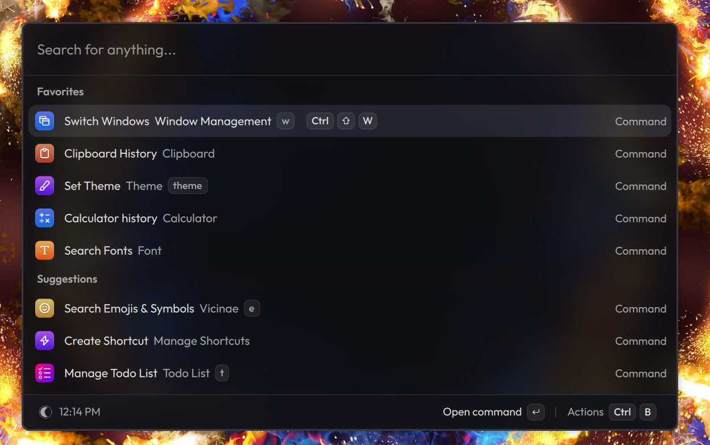

<div>
  <p align="center">
    
  </p>
  
  <h1 align="center"><b>Vicinae</b></h1>
  <h4 align="center">A focused launcher for your desktop</h4>
  
  <p align="center">
     <a href="https://vicinae.com"></a>
    <a href="https://discord.gg/rP4ecD42p7"></a>
  </p>
  
</div>


**Vicinae** (pronounced _"vee-CHEE-nay"_) is a high-performance, native command palette for your desktop.

Out of the box, Vicinae can be your:

- [Dictation](https://docs.vicinae.com/dictation)
- [AI chat](https://docs.vicinae.com/ai)
- app search
- [clipboard history](https://docs.vicinae.com/clipboard)
- [text expander (snippets)](https://docs.vicinae.com/snippets)
- [file search](https://docs.vicinae.com/file-search)
- [browser tab switcher](https://docs.vicinae.com/browser-extension)
- [emoji picker](https://docs.vicinae.com/emoji)
- [calculator](https://docs.vicinae.com/calculator)
- [window/workspace switcher](https://docs.vicinae.com/window)
- font browser
- volume controller

When you need more, Vicinae can be extended in several ways:

- [React/Typescript extensions](https://docs.vicinae.com/extensions/introduction), compatible with the Raycast ecosystem. In-app integration with the [Vicinae store](https://www.vicinae.com/extensions) and the [Raycast store](https://www.raycast.com/store).
- [Script commands](https://docs.vicinae.com/scripts/getting-started), also compatible with the Raycast feature of the same name, with special Vicinae additions.
- [dmenu style menu creation](https://docs.vicinae.com/dmenu), the linux minimalist way!

## Documentation

Everything you need to know to get started with Vicinae is at [vicinae.com](https://vicinae.com). If you have any question, please feel free to come ask it on [discord](https://discord.gg/rP4ecD42p7)!

## Sponsors

### Gold sponsors

<table>
  <tbody>
    <tr>
      <td align="center" valign="middle">
        <a href="https://depot.dev/?utm_source=vicinae&utm_medium=readme" target="_blank">
          <picture>
            <source media="(prefers-color-scheme: light)" srcset="https://depot.dev/assets/brand/horizontal/v2/depot-logo-horizontal-on-light-x3.png" />
            <source media="(prefers-color-scheme: dark)" srcset="https://depot.dev/assets/brand/horizontal/v2/depot-logo-horizontal-on-dark-x3.png" />
            
          </picture>
        </a>
      </td>
    </tr>
  </tbody>
</table>

### Silver Sponsors

<table>
  <tbody>
    <tr>
      <td align="center" valign="middle">
        <a href="https://coderabbit.link/vicinaehq" target="_blank"></a>
      </td>
    </tr>
  </tbody>
</table>

### Supporter sponsors

<table>
  <tbody>
    <tr>
      <td align="center" valign="middle">
        <a href="https://github.com/jaredallard" target="_blank"></a>
      </td>
    </tr>
  </tbody>
</table>

---

[And all our other amazing sponsors!](https://github.com/sponsors/vicinaehq#sponsors)

## Acknowledgments

Special thanks to the [Soulver](https://soulver.app?utm_source=vicinae&utm_medium=readme) team for allowing us to ship SoulverCore as a calculator backend option on macOS.

## Atena fork — Docs root provider

This tree is the Vicinae fork used as **@Search** in the Atena monorepo. Besides
the upstream launcher, it indexes documents from the **Atena Docs** desktop app
as root-search items (one item per `PRESENT` file).

| Piece | Detail |
| --- | --- |
| Index | Read-only SQLite at `$XDG_DATA_HOME/docs/docs.db` (default `~/.local/share/docs/docs.db`) |
| Library files | Absolute paths from the Docs root (`~/.config/docs/root` or `Documents/AtenaData/Docs`) |
| Search fields | File name as title; first subnome + folder as subtitle; tag paths and subnomes also indexed at title weight (so `nfe` ranks like an alias, not a weak keyword) |
| Open | Default action opens the file with the system handler (`QDesktopServices`) |
| Missing DB | Provider loads an empty list — the launcher still starts |

The Docs app owns the database and visits/frecency inside that app. The launcher
only reads the index and applies its own root-search fuzzy + frecency on the
items. Rebuild/install this fork with:

```bash
./scripts/build-and-install.sh
```

Smoke check after install: open the launcher, type a tag alias or file name from
Docs, and confirm the document opens in the default app.

## Atena fork notes

This tree is the Vicinae fork used as **@Search** in the Atena monorepo. Extra
root-search providers talk to sibling apps through their on-disk indexes (no
extra IPC).

### Docs provider

| | |
| --- | --- |
| Provider id | `docs` |
| Index | `$XDG_DATA_HOME/docs/docs.db` (default `~/.local/share/docs/docs.db`) |
| Library root | `~/.config/docs/root` if set, otherwise Documents/`AtenaData/Docs` |
| Items | one root item per document with `status = 'PRESENT'` |
| Keywords | tag paths, tag aliases (subnomes), relative path |
| Open | default app via `QDesktopServices` on the absolute file path |

The index is owned by the **Docs** app. If the database is missing, the provider
loads an empty list and the launcher still starts. Rebuild this fork with
`./scripts/build-and-install.sh` so the provider is in the installed server.
